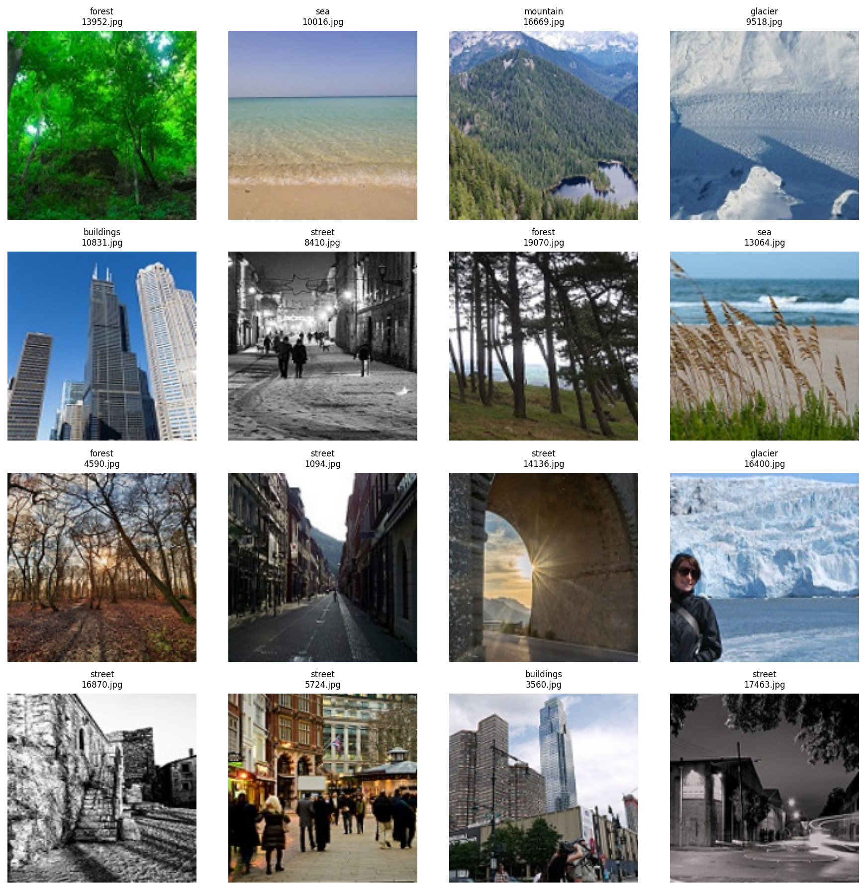
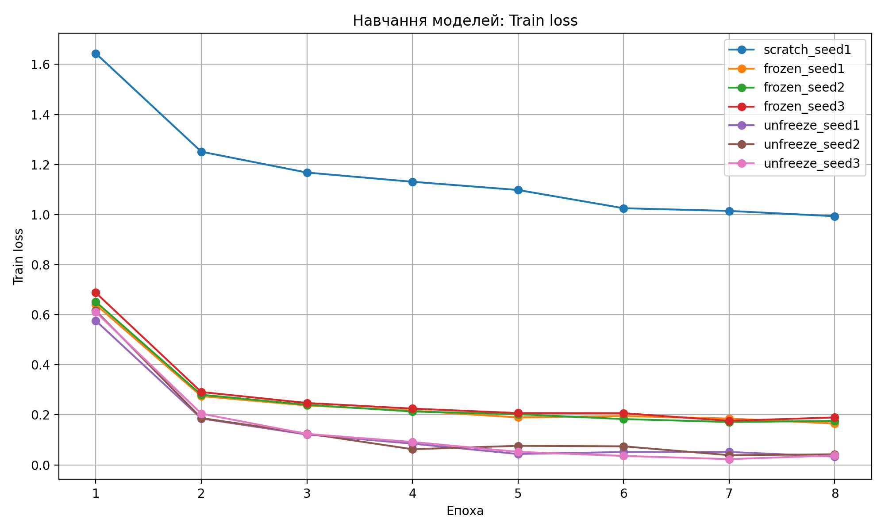
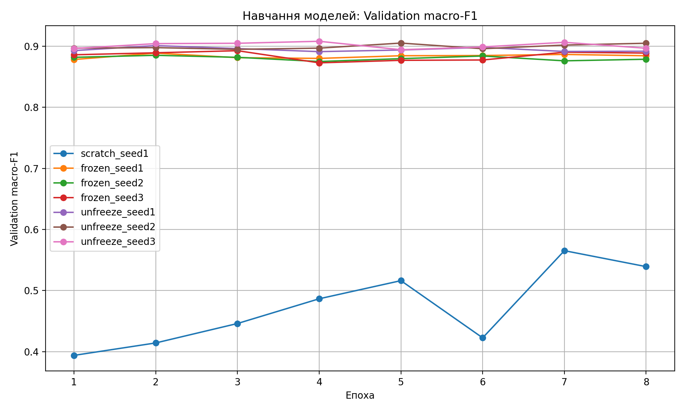
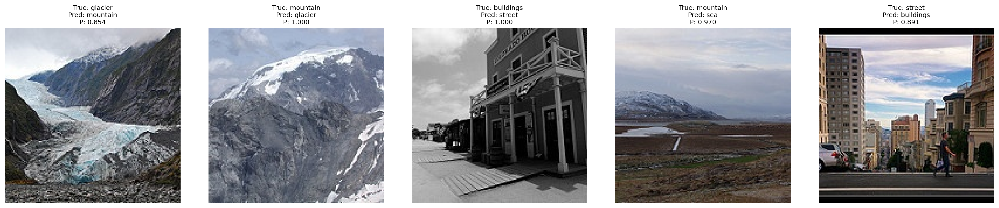

# Лабораторна робота №3. Порівняння режимів навчання ResNet18 на малому наборі даних

## Мета роботи

Дослідити вплив попереднього навчання та донавчання згорткової нейронної мережі ResNet18 на якість класифікації зображень за умов обмеженого обсягу навчальних даних. Порівняти три режими навчання — навчання з нуля, використання замороженої попередньо навченої основи та часткове донавчання backbone — за однакового бюджету оптимізаційних кроків. Оцінити вплив випадкового seed на результати та перевірити якість вибраної моделі на тестовій вибірці.

## 1. Підготовка та перевірка даних

### 1.1. Набір даних

Для експерименту використано набір даних **Intel Image Classification**, що містить зображення шести класів:

1. `buildings` — будівлі;
2. `forest` — ліси;
3. `glacier` — льодовики;
4. `mountain` — гори;
5. `sea` — море;
6. `street` — вулиці.

Відповідність індексів класам зафіксовано в такому порядку: `buildings`, `forest`, `glacier`, `mountain`, `sea`, `street`.

Для роботи використано лише каталоги `seg_train/seg_train` та `seg_test/seg_test`. Каталог `seg_pred` не використовувався. Усі зображення відкривалися за допомогою Pillow з перетворенням у формат RGB.

### 1.2. Формування вибірок

Для кожного класу з навчального каталогу було відібрано по 200 зображень. Перед відбором імена файлів сортувалися як рядки. Для відтворюваності використано генератор випадкових чисел `numpy.random.default_rng(0)`, який послідовно застосовувався до класів.

Із тестового каталогу сформовано валідаційну та тестову вибірки: після перемішування зображень кожного класу перша половина потрапляла до validation, решта — до test. Для цього використовувався окремий генератор випадкових чисел.

Розподіл даних за класами:

| Клас       | Train, кількість | Train, сума індексів | Validation, кількість | Validation, сума індексів | Test, кількість | Test, сума індексів |
| ---------- | ---------------- | -------------------- | --------------------- | ------------------------- | --------------- | ------------------- |
| buildings  | 200              | 1 996 761            | 218                   | 4 837 323                 | 219             | 4 837 559           |
| forest     | 200              | 2 032 625            | 237                   | 5 276 962                 | 237             | 5 291 326           |
| glacier    | 200              | 2 183 923            | 276                   | 6 135 652                 | 277             | 6 157 250           |
| mountain   | 200              | 1 950 345            | 262                   | 5 789 535                 | 263             | 5 849 765           |
| sea        | 200              | 1 987 613            | 255                   | 5 655 068                 | 255             | 5 668 011           |
| street     | 200              | 1 841 817            | 250                   | 5 541 845                 | 251             | 5 547 533           |
| **Усього** | **1200**         | **11 993 084**       | **1498**              | **33 236 385**            | **1502**        | **33 351 444**      |

Перевірка підтвердила відповідність кількості файлів і сум індексів очікуваним значенням для всіх 18 комбінацій «клас — частина вибірки». Загалом отримано 4200 записів і 4200 унікальних файлів. Усі перевірки пройдено успішно.

Файл розподілу `split.csv` має SHA-256:

`a4b693acbd3045782e2bdb155fa214e5f81efaaa25a562a1c030ed321a45774b`

### 1.3. Попередня обробка зображень

Усі зображення приводилися до розміру \(160 \times 160\) пікселів.

Для навчальної вибірки застосовувалися такі перетворення:

- `RandomResizedCrop(160, scale=(0.7, 1.0))`;
- `RandomHorizontalFlip()`;
- `ToTensor()`;
- `Normalize(mean, std)`.

Для validation і test використовувалися:

- `Resize((160, 160))`;
- `ToTensor()`;
- `Normalize(mean, std)`.

Нормалізація виконувалася за статистиками ImageNet:

$$
\mu = (0.485,\ 0.456,\ 0.406),
$$

$$
\sigma = (0.229,\ 0.224,\ 0.225).
$$

Однакові значення нормалізації застосовувалися в усіх трьох режимах навчання, зокрема й під час навчання моделі з нуля.

### 1.4. Перевірка завантаження даних

Після формування вибірок отримано:

- Train: 1200 зображень;
- Validation: 1498 зображень;
- Test: 1502 зображення.

Розмір першого навчального batch:

$$
X_{\text{train}} \in \mathbb{R}^{32 \times 3 \times 160 \times 160},
$$

$$
y_{\text{train}} \in \mathbb{R}^{32}.
$$

Розмір validation batch:

$$
X_{\text{val}} \in \mathbb{R}^{64 \times 3 \times 160 \times 160},
$$

$$
y_{\text{val}} \in \mathbb{R}^{64}.
$$

Отже, завантаження даних і формування batch виконуються відповідно до заданих параметрів.

**Рисунок 1 — Приклади зображень після застосування навчальних перетворень.**



## 2. Порівняння режимів навчання та перевірка параметрів моделі

### 2.1. Архітектура та режими навчання

В усіх експериментах використовувалася архітектура ResNet18 із класифікаційним шаром, заміненим на:

$$
\mathrm{Linear}(512, 6).
$$

Розглянуто три режими навчання.

**Scratch.** Модель ResNet18 ініціалізується без попередньо навчених ваг. Усі параметри моделі доступні для навчання.

**Frozen.** Використовуються попередньо навчені на ImageNet ваги `ResNet18_Weights.IMAGENET1K_V1`. Параметри backbone заморожені, навчається лише новий класифікаційний шар `fc`.

**Unfreeze.** Використовуються попередньо навчені ваги. Навчаються класифікаційний шар `fc` і блок `layer4`, решта backbone заморожена.

Для кожного запуску перед ініціалізацією моделі встановлювалися seed для PyTorch і NumPy.

### 2.2. Кількість параметрів та параметри оптимізатора

У всіх режимах загальна кількість параметрів становить 11 179 590.

| Режим    | Загальна кількість параметрів | Навчувані параметри | Групи оптимізатора |
| -------- | ----------------------------- | ------------------- | --------------------------------------- |
| scratch  | 11 179 590                    | 11 179 590          | усі параметри, `lr=0.003`               |
| frozen   | 11 179 590                    | 3 078               | `fc`, `lr=0.003`                        |
| unfreeze | 11 179 590                    | 8 396 806           | `fc`, `lr=0.003`; `layer4`, `lr=0.0001` |

Використовувався оптимізатор AdamW із параметром:

$$
\mathrm{weight\_decay} = 10^{-4}.
$$

У режимі `unfreeze` для класифікаційного шару та блоку `layer4` застосовувалися різні швидкості навчання. Менше значення для `layer4` дає змогу обережніше адаптувати попередньо навчені ознаки.

### 2.3. Перевірка початкової втрати

Початкову функцію втрат було обчислено до виконання оптимізаційних кроків:

| Режим   | Початкова втрата (\(L_0\)) |
| ------- | ---------------------- |
| scratch | 2.009457               |
| frozen  | 1.969698               |

Для шести класів:

$$
\ln 6 \approx 1.791759.
$$

Обидва отримані значення \(L_0\) перевищують \(\ln 6\). Це саме по собі не означає помилку: початкова втрата залежить від розподілу вихідних логітів моделі, зокрема від випадкової ініціалізації класифікаційного шару та активацій backbone.

### 2.4. Перевірка змін параметрів і буферів

Для кожного режиму виконано п'ять оптимізаційних кроків. До та після них порівнювалися стани модулів, а також буфери BatchNorm.

Результати:

| Модуль   | scratch  | frozen   | unfreeze |
| -------- | -------- | -------- | -------- |
| `conv1`  | змінився | без змін | без змін |
| `bn1`    | змінився | без змін | без змін |
| `layer1` | змінився | без змін | без змін |
| `layer2` | змінився | без змін | без змін |
| `layer3` | змінився | без змін | без змін |
| `layer4` | змінився | без змін | змінився |
| `fc`     | змінився | змінився | змінився |

Зміни статистик BatchNorm:

| Режим    | Статистики BatchNorm      |
| -------- | ------------------------- |
| scratch  | змінилися в усіх блоках   |
| frozen   | не змінилися              |
| unfreeze | змінилися лише в `layer4` |

У режимі `scratch` змінювалися параметри всіх модулів, а також статистики BatchNorm. У режимі `frozen` змінювався лише класифікаційний шар, статистики BatchNorm залишалися незмінними. У режимі `unfreeze` змінювалися параметри `layer4` і `fc`, а статистики BatchNorm — лише всередині `layer4`.

### 2.5. Експеримент із `model.train()`

Окремо перевірено, що відбувається, якщо для замороженої моделі викликати `model.train()` без переведення заморожених BatchNorm-модулів у режим `eval()`.

Очікування перед експериментом:

- параметри backbone не змінюватимуться, оскільки для них вимкнено обчислення градієнтів;
- статистики BatchNorm backbone змінюватимуться, оскільки в режимі навчання вони оновлюють `running_mean` і `running_var`.

Після п'яти кроків отримано:

| Показник для `layer1.0.bn1` | Максимальна абсолютна зміна |
| --------------------------- | --------------------------- |
| `running_mean`              | 0.0928399563                |
| `running_var`               | 0.1203492284                |

Отже, очікування підтвердилися.

Цей експеримент демонструє, що `requires_grad=False` заморожує параметри від оновлення градієнтним оптимізатором, але не зупиняє автоматичне оновлення буферів BatchNorm. Для повного заморожування поведінки backbone необхідно також перевести відповідні модулі BatchNorm у режим `eval()`.

У режимі `frozen` це забезпечено для `conv1`, `bn1` і блоків `layer1`–`layer4`. У режимі `unfreeze` аналогічно заморожені `conv1`, `bn1` і `layer1`–`layer3`, тоді як `layer4` залишається в режимі навчання.

## 3. Проведення семи запусків

### 3.1. Параметри експерименту

Для порівняння режимів виконано сім запусків:

- `scratch`: seed 1;
- `frozen`: seeds 1, 2, 3;
- `unfreeze`: seeds 1, 2, 3.

Для кожного запуску використовувалося:

- 8 епох навчання;
- batch size 32;
- 38 batch за епоху;
- 304 оптимізаційні кроки загалом;
- AdamW із заданими вище параметрами;
- оцінювання validation macro-F1 після кожної епохи.

Останній навчальний batch містив 16 зображень. Середня втрата за епоху обчислювалася з урахуванням розміру batch:

$$
L_{\text{epoch}} =
\frac{\sum_{i=1}^{B} L_i n_i}
{\sum_{i=1}^{B} n_i},
$$

де \(L_i\) — середня втрата на \(i\)-му batch, \(n_i\) — кількість зображень у ньому, \(B\) — кількість batch за епоху.

### 3.2. Метрика якості

Для оцінювання використовувалася macro-F1 — середнє арифметичне F1-score для шести класів.

Для окремого класу:

$$
F1_k =
\frac{2TP_k}
{2TP_k+FP_k+FN_k},
$$

де \(TP_k\), \(FP_k\), \(FN_k\) — кількість істинно позитивних, хибно позитивних і хибно негативних передбачень для класу \(k\).

Macro-F1:

$$
F1_{\text{macro}} =
\frac{1}{6}\sum_{k=0}^{5}F1_k.
$$

Такий спосіб оцінювання надає однакову вагу кожному класу незалежно від кількості його зображень.

### 3.3. Підсумкові результати

У таблиці наведено значення втрати на останній епосі, validation macro-F1 на останній епосі та загальний час навчання кожного запуску.

| Режим    | Seed | Train loss, епоха 8 | Validation macro-F1, епоха 8 | Час, с |
| -------- | ---- | ------------------- | ---------------------------- | ------ |
| scratch  | 1    | 0.993398            | 0.539215                     | 70.9   |
| frozen   | 1    | 0.165533            | 0.884201                     | 35.0   |
| frozen   | 2    | 0.175707            | 0.878500                     | 35.4   |
| frozen   | 3    | 0.189647            | 0.888596                     | 34.5   |
| unfreeze | 1    | 0.033152            | 0.891604                     | 37.3   |
| unfreeze | 2    | 0.042472            | 0.904648                     | 36.1   |
| unfreeze | 3    | 0.037843            | 0.896492                     | 45.3   |

**Рисунок 2 — Зміна train loss протягом восьми епох для всіх семи запусків.**



**Рисунок 3 — Зміна validation macro-F1 протягом восьми епох для всіх семи запусків.**



За результатами видно, що модель `scratch` суттєво поступається двом режимам із попередньо навченими вагами. Її фінальна validation macro-F1 становить 0.539215, тоді як для `frozen` значення перебувають у межах 0.878500–0.888596, а для `unfreeze` — 0.891604–0.904648.

Режим `unfreeze` показав найвище значення validation macro-F1 серед усіх окремих запусків — 0.904648. Водночас остаточне порівняння режимів потрібно виконувати з урахуванням середніх значень і розкиду між seed.

## 4. Аналіз впливу попереднього навчання та донавчання backbone

### 4.1. Середні значення та розкид

Для режимів із трьома запусками обчислювалися середня validation macro-F1:

$$
\overline{F}_r =
\frac{1}{3}\sum_{s=1}^{3}F_{r,s},
$$

та розмах результатів:

$$
R_r =
\max_s F_{r,s} - \min_s F_{r,s}.
$$

Загальний розкид визначався як:

$$
R = \max(R_{\text{frozen}}, R_{\text{unfreeze}}).
$$

Отримані результати:

| Режим    | Середня validation macro-F1 | Розмах (\(R_r\))             |
| -------- | --------------------------- | --------------------------- |
| scratch  | 0.539215                    | не оцінювався (один запуск) |
| frozen   | 0.883766                    | 0.010095                    |
| unfreeze | 0.897581                    | 0.013044                    |

Отже:

$$
R = 0.013044.
$$

### 4.2. Ефект попереднього навчання

Вплив попереднього навчання оцінювався як різниця між середнім результатом `frozen` та результатом єдиного запуску `scratch`:

$$
\Delta_{\text{pre}} =
\overline{F}_{\text{frozen}} -
F_{\text{scratch},1}.
$$

Підстановка значень:

$$
\Delta_{\text{pre}} =
0.883766 - 0.539215 =
0.344551.
$$

Отриманий приріст становить приблизно **0.344551**, або **34.4551 процентного пункта macro-F1**.

Оскільки:

$$
|\Delta_{\text{pre}}| = 0.344551 > R = 0.013044,
$$

ефект попереднього навчання значно перевищує розкид між запусками режимів із попередньо навченими вагами. Це свідчить про суттєву перевагу використання готових ознак ImageNet порівняно з навчанням усієї мережі з нуля за заданого бюджету оптимізаційних кроків.

Водночас для `scratch` виконано лише один запуск, тому власний розкид цього режиму оцінити неможливо.

### 4.3. Ефект донавчання backbone

Вплив розморожування останнього блоку backbone оцінювався як різниця середніх результатів `unfreeze` і `frozen`:

$$
\Delta_{\text{unf}} =
\overline{F}_{\text{unfreeze}} -
\overline{F}_{\text{frozen}}.
$$

Підстановка значень:

$$
\Delta_{\text{unf}} =
0.897581 - 0.883766 =
0.013816.
$$

Отже, донавчання `layer4` дало приріст приблизно **0.013816**, або **1.3816 процентного пункта macro-F1**.

Порівняння з розкидом:

$$
|\Delta_{\text{unf}}| = 0.013816 > R = 0.013044.
$$

Різниця лише трохи перевищує прийнятий поріг \(R\). Тому цей результат варто перевірити на додаткових запусках: наявні дані показують позитивний ефект, але не дають підстав вважати його остаточно доведеним.

### 4.4. Загальний приріст

Сумарний приріст від переходу від `scratch` до `unfreeze`:

$$
0.897581 - 0.539215 = 0.358366.
$$

Водночас сума окремих приростів за округленими значеннями:

$$
0.344551 + 0.013816 = 0.358367.
$$

Незначна різниця в останньому десятковому знаку пов'язана з округленням проміжних значень. За неокругленими значеннями виконується:

$$
\overline{F}_{\text{unfreeze}} -
F_{\text{scratch},1}.
$$

### 4.5. Інтерпретація розкиду та обмеження порівняння

Seed впливає на випадкову ініціалізацію класифікаційного шару, порядок подавання навчальних прикладів і випадкові аугментації зображень. Тому навіть за однакових архітектури та гіперпараметрів результати різних запусків можуть відрізнятися.

У режимах `frozen` і `unfreeze` попередньо навчені ваги backbone однакові, однак випадкова ініціалізація нового класифікаційного шару та випадковість навчального процесу все одно впливають на результат. У режимі `unfreeze` додатково змінюються параметри `layer4`, тому розкид може бути більшим. У проведеному експерименті:

$$
R_{\mathrm{unfreeze}} = 0.013044 > R_{\mathrm{frozen}} = 0.010095.
$$

Важливо враховувати, що \(R\) не є довірчим інтервалом і не дає формального статистичного доведення. Для трьох незалежних спостережень очікуваний розмах приблизно дорівнює \(1.69\sigma\), де \(\sigma\) — стандартне відхилення результатів. Стандартна похибка різниці двох середніх, кожне з яких обчислено за трьома спостереженнями, приблизно дорівнює:

$$
SE_{\text{diff}} \approx 0.82\sigma.
$$

Тому умова \(|\Delta| > R\) є досить суворим орієнтиром, але не замінює статистичного тесту. Сам розмах за трьома значеннями також має значну невизначеність; його стандартне відхилення приблизно дорівнює \(0.89\sigma\).

Крім того, для `scratch` є лише один запуск. Тому розкид цього режиму не характеризується величиною \(R\). Це не змінює арифметичного значення \(\Delta_{\text{pre}}\), але обмежує статистичну інтерпретацію порівняння з навчанням з нуля.

Усі режими мали однаковий бюджет — 8 епох і 304 оптимізаційні кроки. Проте фактичний час навчання відрізнявся: `scratch` потребував 70.9 с, `frozen` — 34.5–35.4 с, `unfreeze` — 36.1–45.3 с. Отже, однаковою була кількість кроків оптимізатора, але не тривалість обчислень.

## 5. Вибір моделі та оцінювання на тестовій вибірці

### 5.1. Правило вибору моделі

Для вибору режиму порівнювалися середні значення validation macro-F1. Найвище середнє значення отримано для `unfreeze`:

$$
\overline{F}_{\text{unfreeze}} = 0.897581.
$$

У межах цього режиму найкращий результат показав запуск із seed 2:

$$
F_{\text{unfreeze},2} = 0.904648.
$$

Тому для фінальної моделі вибрано `unfreeze_seed2`.

Ваги моделі збережено у файлі `lab3_model.pt`. До контрольної точки включено:

- `state_dict`;
- `regime`;
- `seed`;
- `classes`;
- `img_size=160`.

### 5.2. Результати на тестовій вибірці

Після вибору моделі було виконано оцінювання на тестовій вибірці, яка містить 1502 зображення. Інференс проводився на CPU.

Отримано:

| Метрика                               | Значення  |
| ------------------------------------- | --------- |
| Test macro-F1                         | 0.895323  |
| Accuracy                              | 0.892810  |
| Validation macro-F1 вибраного запуску | 0.904648  |
| Різниця Test − Validation             | -0.009325 |

Різниця між тестовою та валідаційною macro-F1:

$$
\Delta_{\text{test-val}} =
0.895323 - 0.904648 =
-0.009325.
$$

Тестове значення нижче за валідаційне. Це узгоджується з тим, що фінальний запуск було вибрано за найкращим результатом на validation серед трьох запусків режиму `unfreeze`. Вибір найкращого результату з кількох запусків може призводити до оптимістичної оцінки на валідаційній вибірці.

Для accuracy стандартна похибка оцінювалася за формулою:

$$
SE_{\text{accuracy}} =
\sqrt{\frac{p(1-p)}{n}},
$$

де \(p\) — точність класифікації, \(n\) — кількість тестових прикладів.

За \(p=0.892810\) та \(n=1502\):

$$
SE_{\text{accuracy}} \approx 0.007982.
$$

Це оцінка похибки саме accuracy, а не macro-F1, тому її не слід безпосередньо трактувати як стандартну похибку різниці між тестовою та валідаційною macro-F1.

Невелика різниця між validation і test може бути наслідком скінченного розміру вибірок та особливостей їхнього складу. Також ефект оптимістичного вибору найкращого запуску не обов'язково має бути великим у кожному конкретному експерименті.

### 5.3. Матриця помилок

Матриця помилок побудована так, що рядки відповідають справжнім класам, а стовпці — передбаченим. Порядок класів: `buildings`, `forest`, `glacier`, `mountain`, `sea`, `street`.

| Справжній клас \ Передбачений | buildings | forest | glacier | mountain | sea | street |
| ----------------------------- | --------- | ------ | ------- | -------- | --- | ------ |
| buildings                     | 197       | 0      | 0       | 0        | 1   | 21     |
| forest                        | 0         | 235    | 0       | 1        | 0   | 1      |
| glacier                       | 2         | 0      | 195     | 69       | 8   | 3      |
| mountain                      | 0         | 0      | 22      | 228      | 12  | 1      |
| sea                           | 2         | 1      | 1       | 4        | 246 | 1      |
| street                        | 11        | 0      | 0       | 0        | 0   | 240    |

Найбільша кількість помилок спостерігається між класами `glacier` і `mountain`: 69 зображень класу `glacier` класифіковано як `mountain`, а 22 зображення класу `mountain` — як `glacier`. Це вказує на схожість візуальних ознак цих класів у наборі даних і є характерною особливістю задачі, а не підставою змінювати розмітку або налаштування моделі після тестування.

### 5.4. Характерні помилки класифікації

Для аналізу вибрано п'ять найчастіших пар помилок «справжній клас — передбачений клас». Для кожної пари було взято перше за алфавітним порядком ім'я файлу. У таблиці наведено ймовірність передбаченого класу, отриману після softmax, та загальну кількість помилок відповідної пари.

| Файл      | Справжній клас | Передбачений клас | Softmax передбаченого класу | Кількість помилок пари |
| --------- | -------------- | ----------------- | --------------------------- | ---------------------- |
| 20111.jpg | glacier        | mountain          | 0.853518                    | 69                     |
| 20320.jpg | mountain       | glacier           | 0.999548                    | 22                     |
| 20246.jpg | buildings      | street            | 0.999991                    | 21                     |
| 20154.jpg | mountain       | sea               | 0.970295                    | 12                     |
| 20734.jpg | street         | buildings         | 0.891059                    | 11                     |

**Рисунок 4 — Приклади п'яти характерних помилок класифікації.**



Візуальний аналіз цих зображень показує, що помилки не обов'язково пов'язані з очевидною неспроможністю моделі розпізнавати об'єкти: сцени можуть містити ознаки кількох класів або бути неоднозначними навіть для людини. Високе значення softmax для помилкового класу свідчить про впевненість моделі у своєму передбаченні, але не гарантує його правильності. Значення softmax не слід трактувати як гарантовано відкалібровану ймовірність правильності.

## 6. Висновки

У роботі було досліджено три режими навчання ResNet18 на наборі Intel Image Classification за однакового бюджету — 8 епох і 304 оптимізаційних кроків для кожного запуску.

Порівняння `scratch` і `frozen` показало значну перевагу попередньо навчених ознак ImageNet. Різниця середньої validation macro-F1 становить:

$$
\Delta_{\text{pre}} = +0.344551.
$$

Це значно перевищує оцінений розкид між запусками (\(R=0.013044\)). Отже, за умов цієї лабораторної роботи використання попередньо навченого backbone має суттєвий позитивний ефект порівняно з навчанням усієї мережі з нуля.

Перехід від `frozen` до `unfreeze` також дав позитивний приріст:

$$
\Delta_{\text{unf}} = +0.013816.
$$

Однак ця різниця лише трохи перевищує оцінений розкид (\(R\)). Тому позитивний ефект донавчання останнього блоку backbone варто перевірити на більшій кількості запусків.

Найкращий середній результат отримано для режиму `unfreeze`, а найкращий запуск цього режиму — `unfreeze_seed2` із validation macro-F1 0.904648. Саме його було збережено як фінальну модель.

На тестовій вибірці модель отримала macro-F1 0.895323 та accuracy 0.892810. Найхарактернішою помилкою виявилося взаємне змішування класів `glacier` і `mountain`, що пояснюється візуальною схожістю частини зображень.

Отже, для нового завдання з обмеженою кількістю даних (200 зображень на клас) доцільно починати з попередньо навченого backbone. Якщо обчислювальний бюджет дозволяє, часткове донавчання останнього блоку може дати додатковий приріст якості, хоча в цьому експерименті його величина близька до оціненого розкиду між запусками.

Важливо, що однакова кількість оптимізаційних кроків не означала однакового часу навчання: `scratch` навчався приблизно вдвічі довше за `frozen`, а `unfreeze` мав дещо більші витрати часу, ніж `frozen`.

## 7. Відтворюваність експерименту

### 7.1. Програмне середовище

Експерименти виконувалися в такому середовищі:

| Компонент         | Версія / значення                  |
| ----------------- | ---------------------------------- |
| Python            | 3.12.                              |
| PyTorch           | 2.11.0+cu128                       |
| torchvision       | 0.26.0+cu128                       |
| NumPy             | 2.3.5                              |
| scikit-learn      | 1.9.0                              |
| Пристрій навчання | CUDA                               |
| GPU               | NVIDIA GeForce RTX 5060 Laptop GPU |

Файл залежностей містить зафіксовані версії використаних бібліотек.

### 7.2. Запуск експериментів

Для відтворення використовуються дві команди: перша формує розподіл даних, виконує перевірки та навчає сім моделей; друга аналізує результати, перевіряє вибір checkpoint і виконує тестове оцінювання.

Команди запуску:

```bash
uv run python train.py
uv run python analysis.py
```

Шлях до набору даних задається безпосередньо у відповідній змінній у коді. Перед запуском необхідно переконатися, що вона вказує на локальне розташування каталогів `seg_train/seg_train` та `seg_test/seg_test`.

Перша команда створює `split.csv`, виконує перевірки розподілу, проводить сім запусків і зберігає журнали навчання та validation logits. Тестова вибірка на цьому етапі не використовується.

Друга команда перевіряє контрольні значення розподілу даних, формує підсумкові таблиці й графіки, обчислює ефекти та перевіряє правило вибору моделі. Після цього завантажується збережений checkpoint і виконується оцінювання на тестовій вибірці на CPU.

### 7.3. Отримані артефакти

У результаті виконання експерименту формуються:

- `split.csv` — фіксований розподіл файлів між train, validation і test;
- каталоги запусків у `runs/` — журнали навчання та validation logits;
- `lab3_model.pt` — фінальна вибрана модель;
- графіки train loss і validation macro-F1;
- візуалізація навчального batch;
- матриця помилок;
- зображення п'яти характерних помилок;
- підсумкові результати аналізу.

Сам набір даних до проєкту не включається. Для відтворення необхідно окремо завантажити Intel Image Classification та вказати шлях до його каталогів.

Невеликі відмінності в числових результатах можуть виникати через недетермінованість окремих GPU-операцій, версії бібліотек або апаратне середовище. Розподіл даних і контрольні перевірки мають відтворюватися зафіксованими seed та алгоритмом формування `split.csv`.

## 8. Використані джерела

1. Intel Image Classification Dataset — набір даних для класифікації зображень.
2. Документація PyTorch — реалізація нейронних мереж, оптимізатора AdamW та механізмів керування режимами навчання.
3. Документація torchvision — архітектура ResNet18, попередньо навчені ваги ImageNet і перетворення зображень.
4. Умова лабораторної роботи №3.
5. ChatGPT (OpenAI) — допомога з поясненням результатів експерименту та підготовкою тексту звіту.
